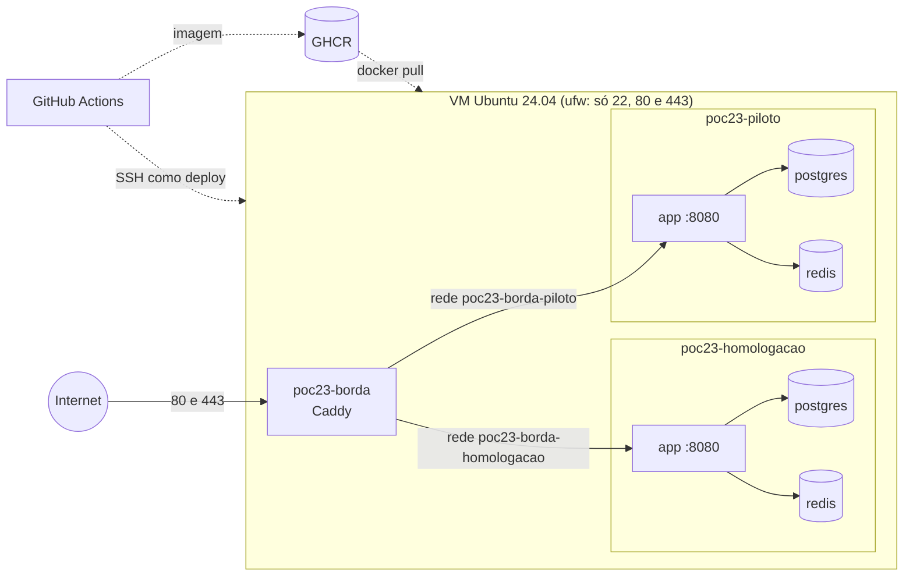

# Hospedagem

Como a POC roda fora da máquina de quem desenvolve: uma VM Linux com Docker Compose e o Caddy gerando o HTTPS (Stack, seção 3). Para reverter uma versão, siga o [roteiro de reversão](reversao.md).

## Arquitetura

Os dois ambientes ficam na mesma VM, cada um em um projeto Compose próprio, com banco, Redis e volumes separados. O Caddy fica em um terceiro projeto, porque só um processo pode usar as portas 80 e 443. Assim, um deploy em homologação nunca reinicia o proxy nem a aplicação do piloto.



| Peça | Onde está | O que faz |
| --- | --- | --- |
| Caddy | [infra/docker-compose.borda.yml](../../infra/docker-compose.borda.yml), [infra/Caddyfile](../../infra/Caddyfile) | Gera os certificados da Let's Encrypt, redireciona HTTP para HTTPS, envia HSTS e bloqueia `/actuator/*`, menos `/actuator/health`. |
| Stack de um ambiente | [infra/docker-compose.yml](../../infra/docker-compose.yml) | Aplicação, PostgreSQL e Redis. Nenhum deles publica portas. |
| Scripts | [scripts/](../../scripts/) | Deploy, reversão, backup e restauração. Rodam na VM. |
| Provisionamento | [infra/provision.sh](../../infra/provision.sh) | Prepara uma VM do zero e pode rodar de novo a qualquer momento. |
| Pipeline | [.github/workflows/](../../.github/workflows/) | Testes, imagem, deploy e reversão. |

### Portas e redes

| Porta | Quem escuta | Acesso |
| --- | --- | --- |
| 22 | SSH da VM | Só com chave. Root e senha recusados. |
| 80 e 443 | Caddy | Público. A 80 só redireciona para a 443. |
| 8080 | Aplicação | Só o Caddy, pela rede `poc23-borda-<ambiente>`. |
| 5432 e 6379 | PostgreSQL e Redis | Só a aplicação do mesmo ambiente, pela rede interna, que não tem saída para a internet. |

Cada ambiente tem a sua rede até o Caddy, então a aplicação de homologação não alcança a do piloto. O ufw não protege portas publicadas pelo Docker, porque o Docker escreve as próprias regras de iptables. Por isso a regra é que só o Caddy publica portas.

### Ambientes

| Ambiente | Domínio | Recebe | Aprovação |
| --- | --- | --- | --- |
| `homologacao` | `DOMINIO_HOMOLOG` | Cada merge na main, com a imagem `sha-<commit>` | Nenhuma |
| `piloto` | `DOMINIO_PILOTO` | Cada tag `v*` (v0.1 na E1, v0.2, v0.3 e v0.4) | Um dos revisores do Environment `piloto` |

O piloto só aceita tags de entrega, e os scripts recusam `sha-` e `latest` nele. A imagem nunca usa `latest`: a tag no ar fica em `IMAGE_TAG`, no `.env` do ambiente, e cada troca é registrada em `historico-deploys.log`.

As duas VMs usam o perfil `prod` do Spring. A configuração dele está em `application-prod.properties`.

### Arquivos na VM

```
/opt/poc23/
├── borda/                    Caddy: .env, Caddyfile, sites/, docker-compose.borda.yml
├── homologacao/
│   ├── .env                  segredos e IMAGE_TAG (permissão 600)
│   ├── historico-deploys.log cada deploy e reversão, com data e hora
│   ├── backups/              dumps diários (permissão 700)
│   ├── infra/                docker-compose.yml da versão implantada
│   └── scripts/              scripts da versão implantada
└── piloto/                   igual à homologação
```

O deploy copia `infra/docker-compose.yml` e `scripts/` para a VM na versão da tag implantada. Mudanças no Caddyfile não vão pelo deploy, porque afetam os dois ambientes: para aplicá-las, atualize o clone na VM e rode o `provision.sh` de novo.

## Segredos

| Segredo | Onde fica |
| --- | --- |
| Senhas do PostgreSQL e do Redis, chave da OpenAI | `/opt/poc23/<ambiente>/.env`, só na VM |
| Domínios e e-mail da Let's Encrypt | `/opt/poc23/borda/.env`, só na VM |
| Chave SSH de deploy, host e `known_hosts` | Secrets dos Environments `homologacao` e `piloto` no GitHub |
| Token do SonarCloud | Secret do repositório |

O repositório só tem os modelos [infra/.env.example](../../infra/.env.example) e [infra/.env.borda.example](../../infra/.env.borda.example), sem valores reais. Gere as senhas com `openssl rand -hex 24`. Senhas só com letras e números evitam problemas com o `$`, que o Compose interpreta.

O usuário `deploy` não tem sudo, mas está no grupo `docker`, e quem controla o Docker controla a VM. Por isso a chave de deploy fica só nos secrets do GitHub e não é reaproveitada para mais nada.

## Provisionar uma VM do zero

Pré-requisitos:
- **VM:** Ubuntu 24.04 LTS com pelo menos 2 vCPU, 4 GB de RAM e 40 GB de disco, para os dois ambientes.
- **Acesso administrativo:** um usuário administrador que não seja root, no grupo `sudo` e com a sua chave SSH em `~/.ssh/authorized_keys`. O script se recusa a rodar sem isso, porque desativa o login de root e por senha.

1. Gere a chave de deploy na sua máquina. A pública vai para a VM e a privada, para o GitHub:

   ```
   ssh-keygen -t ed25519 -N "" -C "github-actions-deploy" -f deploy
   scp deploy.pub admin@IP_DA_VM:
   ```

2. Na VM, clone o repositório e provisione os dois ambientes:

   ```
   git clone https://github.com/lab-simulacoes-conversacionais/lab-simulacoes-conversacionais.git
   cd lab-simulacoes-conversacionais
   sudo infra/provision.sh --chave-deploy ~/deploy.pub homologacao piloto
   ```

   O script instala o Docker pelo repositório oficial e cria o usuário `deploy`. Também deixa o SSH aceitando só chave, liga o ufw com 22, 80 e 443, ativa as atualizações de segurança automáticas, configura a rotação de logs do Docker, cria `/opt/poc23` e instala os timers de backup.

3. Preencha os três `.env` com `sudoedit`: `/opt/poc23/homologacao/.env`, `/opt/poc23/piloto/.env` e `/opt/poc23/borda/.env`.

4. Rode o mesmo comando do passo 2 de novo. Com a borda preenchida, o Caddy sobe e pede os certificados. Rodar de novo nunca sobrescreve `.env`, backups nem histórico.

Com duas VMs, rode o script em cada uma só com o ambiente dela, por exemplo `... --chave-deploy ~/deploy.pub piloto`, e deixe vazio o domínio do outro ambiente na borda.

## Checklist de ações manuais

Estes passos não podem ser feitos pelo repositório. Siga na ordem.

- [ ] **Criar a VM** Ubuntu 24.04 LTS, com o usuário administrador descrito acima.
- [ ] **Registrar os domínios** de homologação e do piloto, e criar registros DNS `A` (e `AAAA`, se a VM tiver IPv6) apontando para o IP da VM. A Let's Encrypt só emite o certificado depois que o DNS responde.
- [ ] **Gerar a chave SSH de deploy** (passo 1 acima).
- [ ] **Rodar o `provision.sh`**, preencher os `.env` e rodar de novo (passos 2 a 4).
- [ ] **Tornar público o pacote no GHCR:** em *Packages* da organização, abra `lab-simulacoes-conversacionais`, depois *Package settings* e *Change visibility*, e escolha *Public*. Assim a VM baixa a imagem sem token. Se a organização bloquear pacotes públicos, libere em *Settings*, *Packages*.
- [ ] **Criar o Environment `homologacao`** em *Settings*, *Environments*, com *Deployment branches and tags* restrito à branch `main`.
- [ ] **Criar o Environment `piloto`** com:
  - *Required reviewers*: as duas pessoas combinadas.
  - *Deployment branches and tags*: branch `main` (usada pelo deploy manual e pela reversão) e tags `v*`.
  - *Prevent self-review* desligado, para que quem dispara a reversão em emergência também possa aprovar.
- [ ] **Cadastrar os secrets nos dois Environments.** Com uma VM só, os valores são os mesmos:
  - `DEPLOY_HOST`: IP ou nome da VM.
  - `DEPLOY_SSH_KEY`: conteúdo do arquivo `deploy` (a chave privada).
  - `DEPLOY_KNOWN_HOSTS`: saída de `ssh-keyscan -t ed25519 IP_DA_VM`. Antes, confira que a impressão digital bate com a do console da VM: `ssh-keygen -lf /etc/ssh/ssh_host_ed25519_key.pub`.
- [ ] **Apagar a chave privada `deploy` da sua máquina** depois de cadastrá-la.
- [ ] **Criar a variável de repositório `DEPLOY_HABILITADO=true`** em *Settings*, *Secrets and variables*, *Actions*, *Variables*. Sem ela, o CI pula os deploys, para a main não ficar vermelha enquanto a VM não existe.
- [ ] **Fazer o primeiro deploy na homologação:** ele acontece no próximo merge na main. Para não esperar, rode na VM o deploy com a tag `sha-` do último commit da main:

  ```
  ssh deploy@IP_DA_VM /opt/poc23/homologacao/scripts/deploy.sh homologacao sha-1234567
  ```

- [ ] **Conferir os critérios de aceite** de fora da VM. Troque `DOMINIO` pelo domínio do piloto:

  ```
  curl -sI http://DOMINIO | grep -iE '^(HTTP|location)'     # 308 para https://
  curl -sI https://DOMINIO | grep -i strict-transport        # HSTS presente
  curl -s -o /dev/null -w '%{http_code}\n' https://DOMINIO/actuator/env   # 404
  for p in 2019 5432 6379 8080; do nc -zv -w 3 DOMINIO $p; done          # todas recusadas
  ```

- [ ] **Publicar a tag `v0.1`,** aprovar o deploy no piloto e fazer o [teste de reversão](reversao.md#teste-de-reversão) na VM, registrando o tempo.

## Backups

O `poc23-backup@<ambiente>.timer` roda o [scripts/backup-postgres.sh](../../scripts/backup-postgres.sh) todo dia por volta das 3h (horário de Brasília), fora do horário letivo. O deploy no piloto também gera um backup antes de trocar a versão. Para rodar à mão:

```
/opt/poc23/piloto/scripts/backup-postgres.sh piloto
```

- **Formato:** `pg_dump -Fc` em `/opt/poc23/<ambiente>/backups/poc23-<ambiente>-<data>-<hora>.dump`. Cada arquivo é conferido com `pg_restore --list` antes de ganhar o nome final.
- **Retenção:** arquivos mais antigos que `BACKUP_RETENCAO_DIAS` (padrão 14) são apagados a cada backup.
- **Conferir se está rodando:** `systemctl list-timers 'poc23-*'` e `journalctl -u poc23-backup@piloto`. Uma falha aparece em `systemctl --failed`.
- **Restaurar:** [scripts/restore-postgres.sh](../../scripts/restore-postgres.sh) `<ambiente> <arquivo>`. O script pede para digitar o nome do ambiente, guarda o estado atual em um backup novo, para a aplicação, recria o banco e restaura. Tudo o que foi gravado depois do backup se perde.

**Os backups contêm as conversas das sessões.** O RN-33 manda excluir as conversas 90 dias depois do fim da POC. Com a retenção de 14 dias, as cópias que ainda tinham essas conversas expiram no máximo 14 dias depois da exclusão. Não aumente a retenção sem rever esse prazo, e não copie backups para fora da VM sem combinar com o grupo.

**Risco aceito:** por enquanto não há cópia externa, então os backups ficam no mesmo disco da VM. Se a VM ou o disco forem perdidos, os backups vão junto. Se o grupo definir um destino externo, ele precisa da mesma retenção.

## Operação do dia a dia

Na VM, como `deploy`:

```
cd /opt/poc23/piloto
docker compose -p poc23-piloto --env-file .env -f infra/docker-compose.yml ps
docker compose -p poc23-piloto --env-file .env -f infra/docker-compose.yml logs --tail 200 app
tail historico-deploys.log
grep IMAGE_TAG .env
```

- **Deploy no piloto sem tag nova:** em *Actions*, abra *Deploy*, clique em *Run workflow* e informe a tag.
- **Sessões:** ficam na memória da aplicação, então todo deploy ou reversão desloga quem estiver conectado. Faça deploy no piloto fora do horário de aula.
- **Logs do Docker:** cada container guarda até 5 arquivos de 10 MB.
- **Atualizações de segurança:** o Ubuntu as instala sozinho, sem reiniciar a VM. Reinicie em um horário sem aula quando `/var/run/reboot-required` existir.

## Validação local

O mesmo proxy pode ser testado na sua máquina, sem domínio, com o `docker-compose.local.yml`. Ele troca os sites por versões com `tls internal` e publica as portas 8088 e 8443 só em `127.0.0.1`.

```
docker network create poc23-borda-homologacao
docker network create poc23-borda-piloto
ACME_EMAIL=dev@exemplo.org docker compose -f infra/docker-compose.borda.yml -f infra/docker-compose.local.yml up -d
```

Para simular uma VM, monte em um diretório qualquer a estrutura de `/opt/poc23/homologacao`:
- crie `infra/` e copie para ele o `docker-compose.yml`;
- copie para a raiz a pasta `scripts/` e o `.env.example`, renomeado para `.env` e preenchido;
- se as imagens vierem de um registry local, acrescente `IMAGE_REPO` ao `.env`.

Depois rode os scripts com `POC23_RAIZ` apontando para esse diretório:

```
export POC23_RAIZ=/caminho/para/poc23
scripts/deploy.sh homologacao v0.0.1
curl -k --resolve homologacao.localhost:8443:127.0.0.1 https://homologacao.localhost:8443/actuator/health
```
